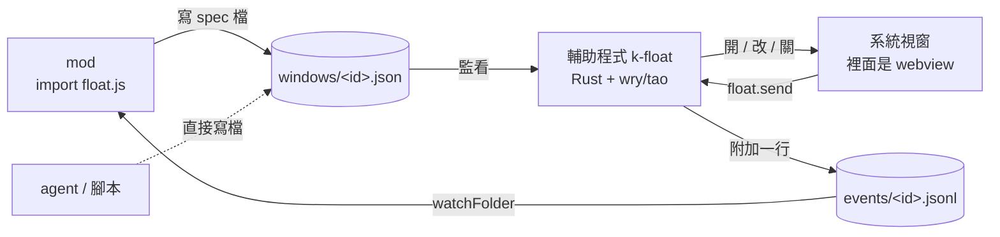

# ADR 0005:讓 mod 開桌面浮動視窗(k-float)

- 狀態:Accepted(2026-11-24 Kirin 定案:輔助程式用 Rust + wry/tao、SDK 是 mod 直接 import 的 JS 模組)
- 日期:2026-11-24
- 相關:Tide #294、ADR 0002(浮動筆記;它的階段 B 由本篇取代)、ADR 0003(同樣用檔案傳內容)、`exec` / `writeTextFile` / `readTextFile` / `watchFolder`(`herdr.d.ts`)

## 背景

ADR 0002 只想做一張筆記。2026-11-24 範圍擴大:不侷限筆記,給 mod 一套「開桌面浮動視窗」的 SDK,任何 mod 都能用;筆記變成第一個用例。

限制沒變:mod 的 `openOverlay({ kind: "window" })` 只畫在 Herdr 主視窗裡,蓋不過瀏覽器等其他程式,Herdr 最小化就看不到。要蓋過整個桌面,一定要有一支**輔助程式**去開真正的系統視窗。

第一版的要求:

- 支援 Windows(laptop)與 Linux Mint(back,X11)。
- 視窗置頂,蓋過其他程式;Herdr 最小化仍看得到。
- mod 把自己要的 UI(HTML + JS)顯示在視窗裡;按鈕、輸入、點擊都要傳回 mod。
- 內容更新、關閉都由 mod 控制;使用者自己關掉視窗,mod 收得到。

## 決定

### 1. 三個部分



| 部分 | 位置 | 做什麼 |
|---|---|---|
| 輔助程式 `k-float` | `tools/k-float/`(Rust crate;裝到 `<App home>/tools/k-float`,跟 k-chat 的主持程式同一個慣例) | 常駐一支,照 spec 檔開、改、關視窗;把視窗事件寫進事件檔 |
| SDK `float.js` | `mods/k-float/float.js` | mod import 它:`open` / `update` / `close` / `get` / `listen`;負責啟動輔助程式、寫 spec、讀事件 |
| 檔案協定 | `<App home>/data/k-float/` | spec 檔與事件檔的格式,寫成文件(`doc/k-float-protocol.md`);agent、腳本不經 mod 直接寫檔也能開視窗 |

### 2. 輔助程式:Rust + wry/tao

- 一份程式碼,Windows 用 WebView2、Mint 用 WebKitGTK,視窗內容直接是 HTML。
- 每台建出一支單檔執行檔,不用另裝執行環境。兩台都已有 `cargo`,各自 `cargo build --release`,不交叉編譯。
- 用法:
  - `k-float start <資料夾>`:在背景另起一支常駐的自己,然後馬上結束。mod 用這個,因為 `exec` 最多等 10 分鐘,不能讓 `exec` 等著常駐程式。
  - `k-float run <資料夾>`:留在前景跑(除錯用)。
- 同一個資料夾只會有一支在跑(鎖檔 `helper.lock`);重複 `start` 不會多開。
- 沒有任何視窗超過 30 秒就自己結束,下次 `open` 再由 SDK 叫起來。
- 置頂用 tao 的 `always_on_top`。
- 點穿(滑鼠穿過視窗):用 tao 的 `set_ignore_cursor_events`。2026-11-24 在 Linux(X11)測試環境實測有效(開了之後點筆記、打字,筆記內容不變)。哪個平台做不到,就在事件檔記一筆 `warning`,其他功能照常。

### 3. SDK:`float.js`

```js
import { float } from "./float.js";    // 自己 mod 資料夾裡的那份複本

// 在 init(props, cx) 裡,先聽再開
float.listen(cx, "note", (ev, cx) => {
  // { type: "message", data: "add" }          頁面呼叫 float.send(…)
  // { type: "closed", by: "user" | "spec" }   使用者關掉 / spec 被刪
  // { type: "moved", x, y } / { type: "resized", width, height }
  return float.update("note", { data: { count: 3 } });
});

await float.open({
  id: "note",                       // 同一個 id 再 open = 換掉
  html: "<button onclick=\"float.send('add')\">+</button>",
  x: 40, y: 40, width: 280, height: 220,
  topmost: true,                    // 預設 true
  clickThrough: false,
  opacity: 1,             // 整個視窗的不透明度 0–1(2026-11-25 加)
  title: "Note",
});

await float.close("note");
```

- **跨 mod import 驗不過**(2026-11-24 測試環境:`herdr-app check` 回 `module ../k-float/float.js resolves outside the application directory`)。照定案的備案:要用的 mod 自己放一份 `float.js` 複本(`cp mods/k-float/float.js mods/<mod>/float.js`),API 不變;`tests/k-float.test.js` 檢查每份複本跟原檔一字不差。
- 聽事件的函式是 `listen(cx, id, handler)`,不是草案的 `on(id, handler)`:mod 裡沒有 `setTimeout`,背景工作一定要掛在某個 `cx` 上(`cx.spawn`),所以要多傳一個 `cx`;mod 那份畫面關掉,監聽也跟著停。
- 頁面那一側,輔助程式會注入 `window.float`:
  - `float.send(data)`:傳一筆訊息回 mod(任何可轉成 JSON 的值)。
  - `float.onData(fn)`:mod 用 `update(id, { data })` 送來新資料時呼叫。只換資料、不重新載入頁面,輸入到一半的字不會掉。
- `update(id, { html })` 會重新載入整頁;`update(id, { data })` 不會。位置、大小、`topmost`、`clickThrough`、`opacity` 也都可以 `update`。

### 4. 檔案協定(細節在 `doc/k-float-protocol.md`)

資料夾:`<App home>/data/k-float/`(每個 profile 視窗各一份,跟 App home 走)。

| 檔案 | 誰寫 | 內容 |
|---|---|---|
| `windows/<id>.json` | mod / agent / 腳本 | 一個視窗的 spec。檔案出現 = 開、內容變 = 更新、刪掉 = 關 |
| `events/<id>.jsonl` | 輔助程式 | 每行一筆事件,帶遞增的 `seq`;讀的人自己記讀到哪個 `seq` |
| `helper.lock` | 輔助程式 | pid 與版本,用來確認只有一支在跑 |

- 使用者自己關掉視窗時:輔助程式寫 `closed` 事件並刪掉 spec 檔,所以重開輔助程式不會把它又開回來。
- 視窗被拖動 / 改大小時:寫 `moved` / `resized` 事件,並把新位置寫回 spec 檔,下次開在同一個位置。

### 5. 第一個用例:筆記(mod `k-note`)

- 用 `float.js` 開一張置頂筆記,內容存 `<App home>/data/k-note/note.md`。
- 筆記可以直接在視窗裡編輯(頁面 `float.send` 把新內容傳回 mod,mod 用 `writeTextFile` 帶 `expected` 存檔)。
- mod 用 `watchFolder` 監看 `note.md`;agent、腳本改檔,筆記就更新(`update(id, { data })`)。
- mod 要有一份畫面活著才收得到事件(存檔、記位置都靠它)。所以 k-note 在 Herdr 裡是一個小面板(`kind: "window"`),當作筆記的開關:面板開著,桌面筆記就在;關掉面板或關掉筆記,兩個一起關。切換版面時面板會被 Herdr 關掉,筆記也跟著關(已知限制)。
- ADR 0002 的階段 A(Herdr 視窗內的 `kind: "window"` 筆記)不在這張卡的範圍。

## 不選的做法

- **Tauri 完整框架**:底層同樣是 wry/tao,多出來的打包、安裝檔、前端工具鏈這裡用不到。
- **兩台各寫各的**(Mint 用 Python + GTK、Windows 用 C# WPF):兩份程式碼,行為要各自對齊。
- **Electron**:每台要帶 100 MB 以上的執行環境,常駐吃的記憶體多。
- **k-float 當服務、其他 mod 用 `shared` 溝通**:`shared.json` 每個視窗各一份,事件要經 `shared` 轉一手,而且 k-float mod 一定要載入。
- **用 localhost HTTP 溝通**:要處理埠號、輔助程式有沒有在跑;而且 agent、腳本要開視窗時,寫一個檔比打 HTTP 簡單,狀態也看得到(spec 檔在不在 = 視窗開著嗎)。(ADR 0002 寫「mod 沒有 `fetch`」已過時:現在的 Herdr 有 `fetch`,但不是選檔案的主因。)

## 限制

- Wayland 不保證置頂。Mint 預設是 X11,可接受。
- 事件走檔案,mod 收到會慢一拍(`watchFolder` 的延遲),不適合拖曳這類要即時回應的互動;那種互動寫在頁面自己的 JS 裡。
- 頁面是本機 HTML 字串,第一版不載外部網址。

## 待決

1. 筆記要不要多張?第一版先做一張(`id: "note"`)。
2. 跨機:back 的 mod 用 `exec(..., { on: "laptop" })` 叫出 laptop 的視窗,第一版不做(spec 檔在對面,`writeTextFile` 沒有 `on`)。
